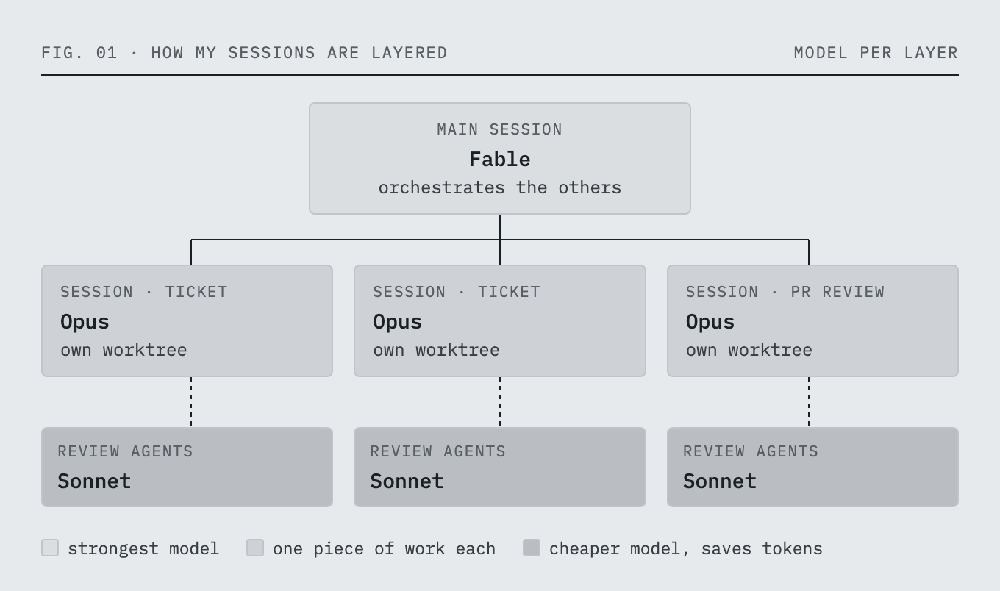

Code editors and IDEs are built for working on code by hand: typing it, jumping around it, refactoring it, stepping through it in a debugger. For years, that's how I spent most of my day. But so much has changed in the last few years.

Claude writes most of the code I ship now. My part is orchestrating it: describing what I want, steering when it goes the wrong way, and reviewing what comes out. Keeping an editor at the center of my day stopped making sense, so these days I do my coding in the Claude desktop app. I still open VS Code, but to read code, not to write it.

## How I got here

For a long time, my setup was VS Code with Claude Code running in a terminal beside it. But once Claude was doing most of the writing, the terminal was where the work happened, and the editor was just where I went to check it. So I started trying terminals. The default macOS Terminal first, then Ghostty, then Warp. After that I moved on to multiplexers built for running coding agents side by side. I used [cmux](https://cmux.com) for a while and it never clicked for me. Then I found [Herdr](https://herdr.dev), and that one stuck. I used it for a month or two and liked it a lot.

Then I started hitting small issues. When I pasted an image into a session, I didn't get a thumbnail of it, so I couldn't see what I had sent. It seemed like a strange thing to be missing. It wasn't enough to make me leave on its own, but this time I wanted to try something different, so I gave the Claude desktop app a go.

I tried it for a day or two, liked it a lot, and I've been using it ever since. I don't think I'm going back.

## Isn't this just Claude Code in a window?

Underneath, it is. The desktop app runs the same Claude Code I was running in Herdr. What changes is how much of it I can see.

In a terminal, a session is a log that keeps scrolling. A background task or a connector shows up as a line, and a few minutes later it's gone off the top of the screen. In the app, all of that stays on screen:

- Every session sits in the sidebar, each in its own git worktree, so two sessions can work on the same repository without touching each other's files. Sessions from different repositories sit in the same list.
- Each session shows which connectors are running, which background tasks it has started, and its task list.
- For a branch with a PR, the PR's status and its CI checks sit next to the conversation.

Before the app, if I wanted Claude to look at a running app, I had to set up something like the Playwright MCP server and keep it working. Now the browser is right there. Claude opens the dev server in a pane next to the conversation, and I see the same page it does. It's the feature I like the most.

## Everything in one window

My work used to be spread across windows: the editor, the terminal, a Chrome window for anything I needed to look at, and a video player whenever I made a video. But the browser is only part of what changed: in the app, I don't have to leave the window at all.

When I'm working on an artifact, like a design, it opens in a pane next to the conversation instead of in a separate Chrome window. When a session writes a markdown file, I read it right there. And it goes past code, too. Sometimes I create videos, and they play right in the app. When I'm making slides, they open there as well. It's very handy.

Everything I need for a session is in this one window, and I don't have to go looking for a different one.

## How I work in the app

At work, I keep one main session open that orchestrates the others. Every other session is one piece of work: a ticket, a PR review, or anything else on my plate.

Each layer runs on a different model. The main session usually runs on the most powerful one, Fable. The sessions under it usually run on Opus. Review agents and other smaller helpers run on a weaker model like Sonnet. That split helps me save tokens.

For reviews and QA, the sessions use [kc-claude-kit](https://github.com/kcsujeet/kc-claude-kit), my own Claude Code toolkit. It holds my coding conventions, a gate-based code review, and the skills I use to verify a change.

The browser is where this pays off. When a change is ready, I tell Claude what to QA, and it goes through the UI the way a user would. It clicks through buttons, opens and closes forms and modals, fills out forms, and tries the different states along the way. It can also go through the same flow as different personas, so what gets checked is a real user's flow from start to end.

## I haven't uninstalled VS Code yet

I know the title says goodbye to code editors, but there's still one thing I go back to VS Code for: source control. I think VS Code's Source Control view and its side-by-side diff editor are phenomenal, and I don't like the diff view in the desktop app nearly as much. I even tried building my own diff view for the app and gave up after two versions.

So when a session is done, I open its folder in VS Code and skim through the changes in Source Control to see if anything stands out. Then I go back to the app to steer the next round. That's reading code, not writing it, and for reading a diff VS Code is still the best tool I have.

This is the only thing I open it for. I think it's only a matter of time before the desktop app catches up on source control, and when it does, I'll uninstall VS Code too.

## What I do now

- Keep one main session that orchestrates the others, on the strongest model (Fable).
- Run the sessions under it on Opus, and review agents on a cheaper model like Sonnet, to save tokens.
- Put your review and QA steps in a toolkit the sessions can share. Mine is [kc-claude-kit](https://github.com/kcsujeet/kc-claude-kit).
- Run one session per ticket or review, each in its own worktree, so parallel work on the same repository doesn't collide.
- Tell Claude what to QA and let it click through the flow in the built-in browser, as more than one persona, instead of wiring up a Playwright MCP server.
- Keep the PR status and CI checks next to the session that made the change.
- Open artifacts, files, videos and slides in the app's side panes instead of a separate browser window or player.
- Review diffs in a real diff tool. For me that's VS Code's Source Control, opened on the session's folder.
